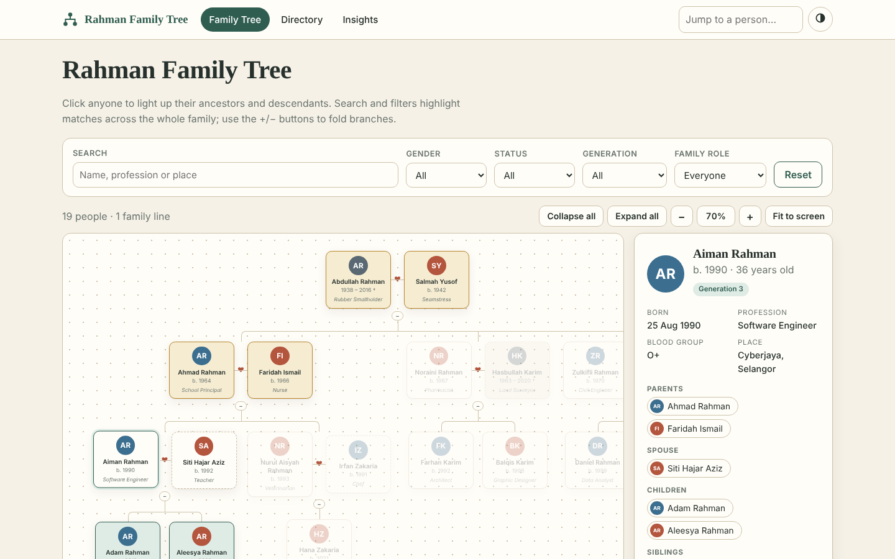
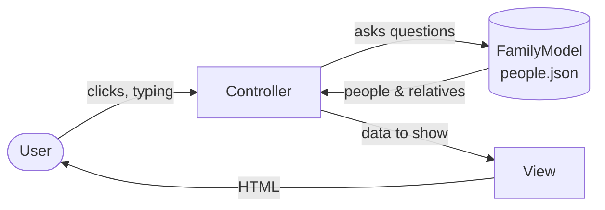
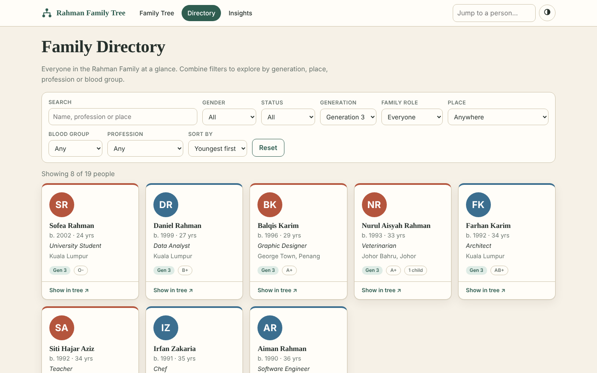
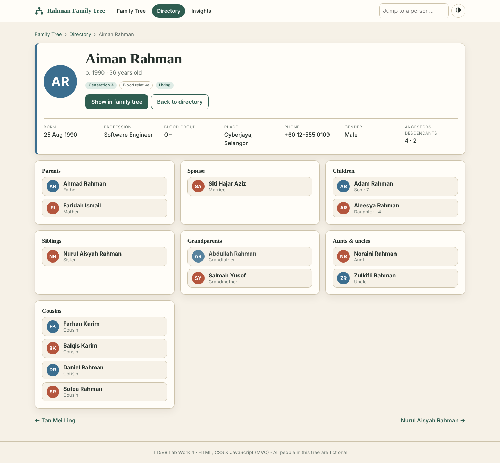
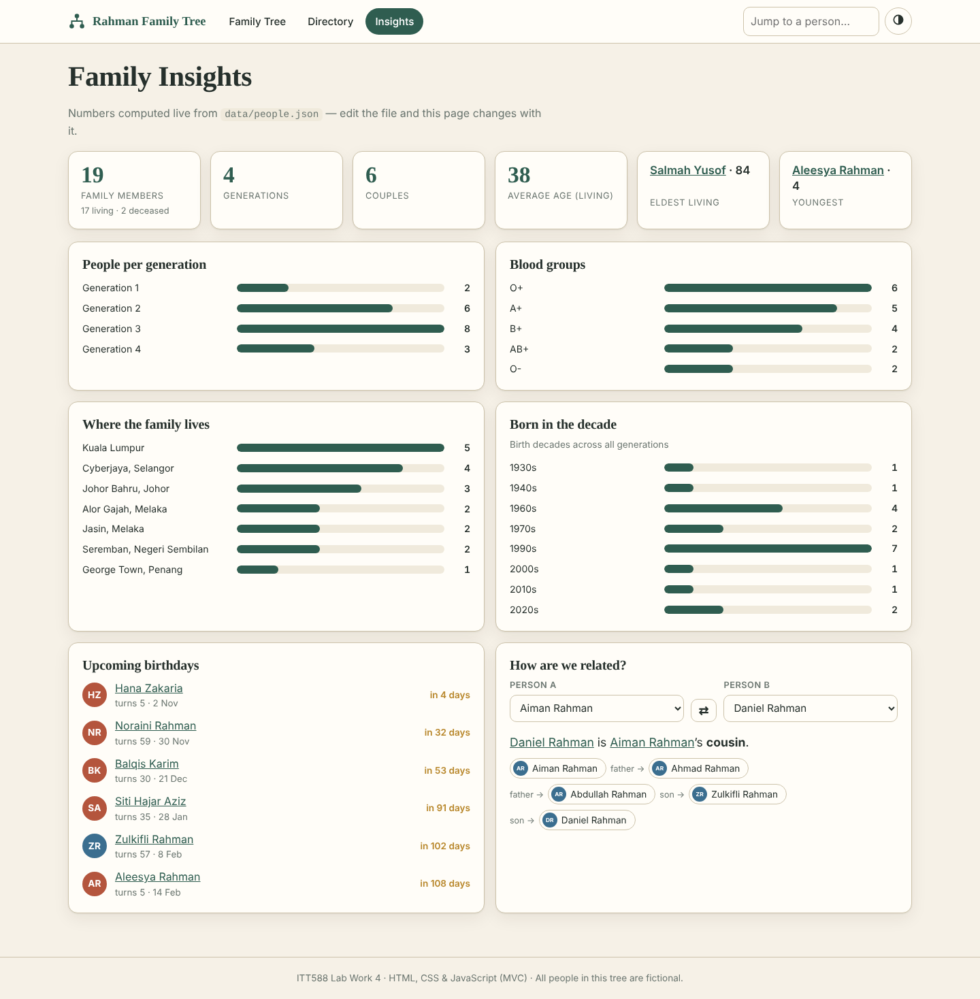

# Rahman Family Tree

**ITT588 · Lab Work 4 — Family heritage viewer built with HTML, CSS, JavaScript and the MVC pattern.**

An interactive family-tree website that reads a JSON dataset (`data/people.json`), works out
parents, spouses, children and other relatives with JavaScript, and shows them across four pages.
All people in the dataset are **fictional**.



## Lab objectives → where they are met

| Objective | Implementation |
|---|---|
| Retrieve and process family data from JSON with JavaScript | `fetch('data/people.json')` in `FamilyModel.load()`; indexes, derived children, generations, ages, statistics |
| Display members and relationships dynamically | Tree, directory and profile pages are all generated from the JSON by the views |
| Visualise parents, spouses and children | Nested tree with pure-CSS connectors, ♥ bonds between spouses, relative tiles on each profile |
| Filtering and navigation | Search + 8 filters, sorting, click-to-highlight lineage, folding branches, zoom, deep links, jump-to-person box, prev/next, breadcrumbs |
| Requirements: JSON · CSS · JavaScript · MVC | See the structure below |

## Pages

| Page | What it does |
|---|---|
| `index.html` – **Family Tree** | Whole tree on one canvas. Click a person to highlight their ancestors (gold) and descendants (green) and open a detail panel. Search/filter dims everyone who doesn't match. Fold/unfold branches, zoom, fit to screen. |
| `directory.html` – **Directory** | Card grid of everyone. Filter by name, gender, status, generation, family role, place, blood group and profession; sort by name, age or generation. |
| `person.html?id=p9` – **Profile** | Facts plus clickable tiles for parents, spouse, children, siblings, grandparents, aunts & uncles and cousins. |
| `insights.html` – **Insights** | Statistics, bar charts, upcoming birthdays and a **"How are we related?"** finder (breadth-first search over parent/child/spouse links). |

Extras: light/dark theme (remembered), responsive layout, keyboard-accessible controls, print stylesheet.

## Run it

Browsers block `fetch()` on files opened straight from disk, so serve the folder:

```bash
cd family-tree
python3 -m http.server 8080      # then open http://localhost:8080
# or: npx serve .   |   VS Code "Live Server" extension
```

Run the unit tests for the model (Node 18+):

```bash
node tests/model.test.mjs
```

### Publish on GitHub Pages
1. Push this folder to a GitHub repository.
2. **Settings → Pages → Deploy from a branch → `main` / root**.
3. Your site appears at `https://<username>.github.io/<repo>/`.

## MVC structure

```
family-tree/
├── index.html · directory.html · person.html · insights.html   # page shells
├── css/style.css
├── data/people.json                    # the dataset
├── js/
│   ├── utils.js                        # escaping, dates, form helpers
│   ├── models/FamilyModel.js           # MODEL      - data + all relationship logic
│   ├── views/                          # VIEW       - build HTML, no data logic
│   │   ├── LayoutView.js   components.js
│   │   ├── TreeView.js     DirectoryView.js   PersonView.js   InsightsView.js
│   └── controllers/                    # CONTROLLER - events ↔ model ↔ view
│       ├── BaseController.js
│       └── TreeController.js  DirectoryController.js  PersonController.js  InsightsController.js
└── tests/model.test.mjs
```



* **Model** never touches the DOM. It exposes `getParents`, `getSpouses`, `getChildren`, `getSiblings`,
  `getCousins`, `getAncestors`, `getDescendants`, `generationOf`, `filter`, `sort`, `stats`,
  `upcomingBirthdays` and `relationship`.
* **Views** receive data and return/insert HTML (everything is escaped with `esc()`).
* **Controllers** read the URL and form fields, call the model, and tell the view what to draw.

## Dataset format

Same schema as the lab's sample file. Children are **not stored**; they are derived from
`fatherId` / `motherId`.

```json
{
  "id": "p3",
  "name": "Ahmad Rahman",
  "gender": "male",
  "photo": "",
  "phone": "+60 12-555 0103",
  "address": "Alor Gajah, Melaka",
  "dob": "1964-05-19",
  "dateOfDeath": "",
  "profession": "School Principal",
  "bloodGroup": "O+",
  "fatherId": "p1",
  "motherId": "p2",
  "spouses": [{ "id": "p6", "status": "married" }],
  "isInLaw": false
}
```

* `spouses[].status` can be `married`, `divorced` or `widowed`.
* `isInLaw: true` marks people who married into the family (shown with a dashed border).
* `photo` can be an image path (e.g. `img/p3.jpg`); otherwise initials are shown.
* The tree starts from every blood relative with no parents recorded, so you can describe your own
  family by replacing `data/people.json` – no code changes needed.

**Using your own family:** keep the field names, give every person a unique `id`, make spouse links
mutual, and run `node tests/model.test.mjs` – the integrity test reports missing or one-way references.

## Screenshots

| Directory | Profile | Insights |
|---|---|---|
|  |  |  |

## How the tree is drawn (short explanation for your report)

1. The model finds the roots (blood relatives without parents).
2. `TreeView.renderTree()` calls a recursive `unit(person)` function. A *unit* is the person, their
   spouses and – inside a nested `<ul>` – a unit for each child. A `rendered` set stops anyone being drawn twice.
3. CSS draws the lines using `::before` / `::after` borders on each `<li>`, so no canvas or SVG library is needed.
4. Selecting a person asks the model for ancestors and descendants and the view toggles CSS classes
   (`.anc`, `.desc`, `.dim`) on the cards.

## Submission ideas

* **GitHub article:** this README plus the live GitHub Pages link.
* **YouTube video (3–5 min):** show each page → show `people.json` → show the Model/View/Controller folders → edit one person in the JSON and refresh to prove the page is data-driven.
* **Slides:** Objective · Dataset design · MVC architecture diagram · Screenshots of each page · Challenges (duplicate spouses, in-law generations, tree connectors) · Conclusion.

## Tech

Plain HTML5, CSS3 (custom properties, grid, flexbox) and ES modules — no build step, no dependencies.
Fonts (Fraunces, Inter) load from Google Fonts with system-font fallbacks.
